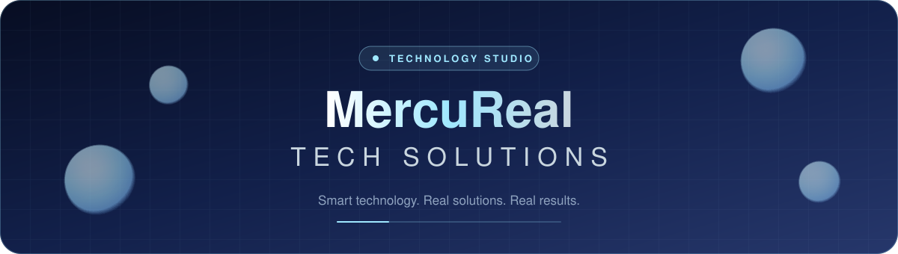
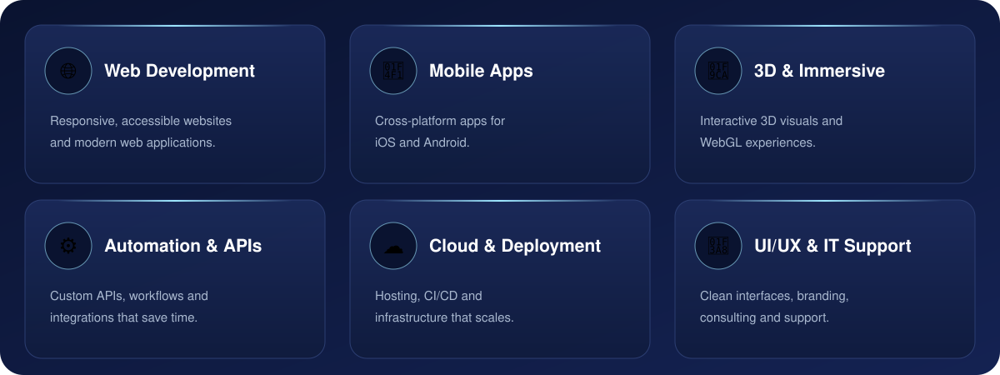
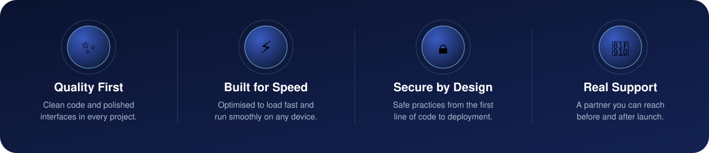
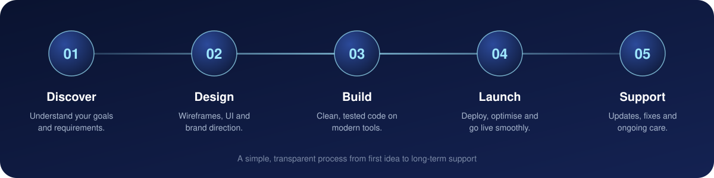
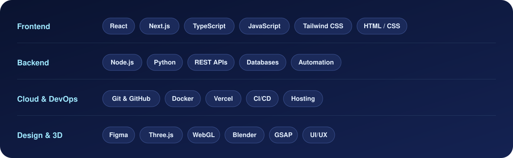
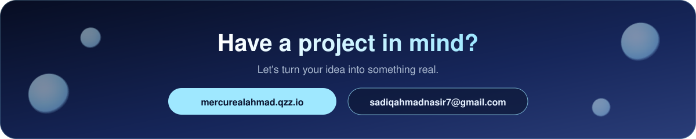

<!-- ============================================================
  MercuReal Tech Solutions: GitHub profile README
  Repo layout:  README.md  +  assets/ folder containing
  logo.png, banner.svg, services.svg, why.svg, process.svg,
  stack.svg, cta.svg, divider.svg
============================================================ -->

 

## About

**MercuReal Tech Solutions** builds practical, modern technology for people and businesses. Like mercury, our work is adaptable, precise and shaped around what you need, from websites and apps to automation and cloud systems.

> *"Technology should work for you, not the other way around."*

<table>
<tr>
<td width="33%" valign="top">

**💡 Tailored** 
Every project starts with your goals, so the solution fits your business.

</td>
<td width="33%" valign="top">

**⚡ Fast & Secure** 
Modern tools and clean engineering for speed, safety and scale.

</td>
<td width="33%" valign="top">

**🤝 Reliable** 
Clear communication, honest timelines and support after launch.

</td>
</tr>
<tr>
<td width="33%" valign="top">

**📱 Responsive** 
Interfaces that look and work great on every screen size.

</td>
<td width="33%" valign="top">

**🧊 Creative** 
3D and interactive touches that make your brand memorable.

</td>
<td width="33%" valign="top">

**🔧 Maintainable** 
Clean, documented code that is easy to extend later.

</td>
</tr>
</table>

## Services

## Why MercuReal

## How We Work

## Tech Stack

 

## FAQ

<b>How do we get started?</b>

 

Send a short message through the website or by email describing what you want to build. We'll reply, talk through your goals and agree on the next steps.

<b>What do you need from me?</b>

 

Your goals, any content or brand assets you already have, and examples of designs you like. If you're not sure yet, we can figure it out together.

<b>Do you only build 3D websites?</b>

 

No. 3D is one of our specialties, but we also build regular websites, mobile apps, APIs, automations and cloud setups.

<b>Do you offer support after launch?</b>

 

Yes. We can handle updates, fixes and improvements after your project goes live.

<b>📊 GitHub activity</b>

 

## Contact

 

 

🟢 **Open for projects** · web · mobile · automation · cloud · 3D

<!-- ============================================================
  REPO "ABOUT" BOX (right sidebar of the repo)
  Description: Technology solutions company: web, mobile, cloud, automation & 3D experiences ✦ MercuReal Tech Solutions
  Website:     https://mercurealahmad.qzz.io
  Topics:      software-development web-development mobile-apps cloud
               automation api-development ui-ux threejs it-solutions
============================================================ -->
